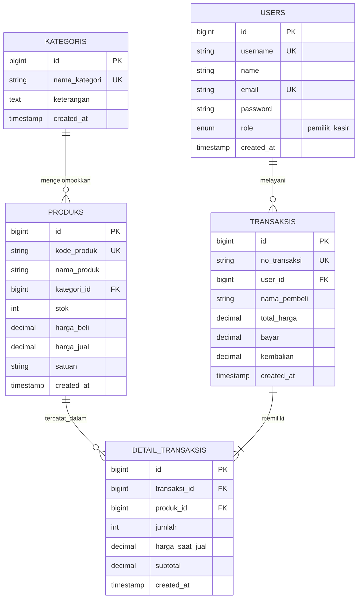
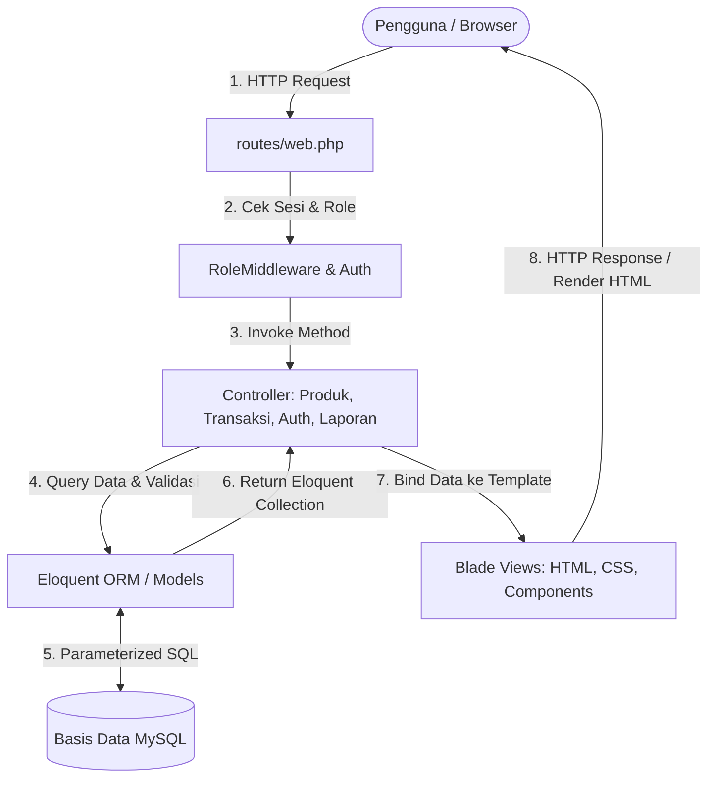

# DOKUMEN LAPORAN & MATERI SUBMISSION UAS
## Web Application Development — Universitas Cakrawala

---

## 1. Identitas Project
* **Nama Aplikasi:** Toko Sembako Berkah (Sistem Manajemen Operasional & Finansial Sembako)
* **Kategori Studi Kasus:** Sistem Manajemen Inventaris & E-Commerce / POS UMKM Lokal
* **Arsitektur:** Full-Stack Server-Side Model-View-Controller (MVC) Framework Laravel
* **Basis Data:** Relational Database MySQL
* **Bahasa Pemrograman:** PHP 8.2 & Blade Templating Engine

---

## 2. Deskripsi & Latar Belakang Proyek
Toko Sembako Berkah merupakan solusi digital bagi pelaku usaha mikro, kecil, dan menengah (UMKM) sektor sembako. Aplikasi ini memfasilitasi pencatatan finansial dua arah (pemasukan dan pengeluaran barang), pemantauan stok menipis secara *real-time*, proses kasir penjualan (*Point of Sale*) yang cepat dengan kalkulasi uang kembalian dan pemotongan stok otomatis, pencetakan nota/struk belanja fisik, serta laporan laba-rugi terpadu berdasarkan Harga Pokok Penjualan (HPP).

---

## 3. Desain Entity Relationship Diagram (ERD) — CPMK1

Sistem ini menerapkan skema relasional 5 tabel ternormalisasi (3NF):

### Relasi Antar Tabel:
1. **`users` &rarr; `transaksis` (1 to Many):** Setiap transaksi kasir dicatat oleh satu user (kasir/pemilik) sebagai penanggung jawab transaksi.
2. **`kategoris` &rarr; `produks` (1 to Many):** Satu kategori membawahi banyak produk sembako.
3. **`transaksis` &rarr; `detail_transaksis` (1 to Many, Cascade on Delete):** Satu nota transaksi memiliki satu atau banyak item barang belanjaan.
4. **`produks` &rarr; `detail_transaksis` (1 to Many, Restrict on Delete):** Produk yang telah tercatat dalam riwayat transaksi diproteksi agar tidak bisa terhapus sembarangan guna menjaga integritas data akuntansi.

---

## 4. Flowchart & Diagram Alur Arsitektur MVC — CPMK1

---

## 5. Rincian Hak Guna Akses Pengguna (Role-Based Access Control) — CPMK4

| Fitur / Modul | Pengunjung (Tamu) | Kasir (`kasir`) | Pemilik Toko (`pemilik`) |
| :--- | :---: | :---: | :---: |
| Lihat Katalog Produk & Stok | ✅ Ya | ✅ Ya | ✅ Ya |
| Registrasi & Login Akun | ✅ Ya | ✅ Ya | ✅ Ya |
| Dashboard Ringkasan Finansial | ❌ Tidak | ✅ Ya | ✅ Ya (Lengkap dengan laba kotor) |
| Tambah / Edit / Hapus Produk | ❌ Tidak | ❌ Tidak | ✅ Ya (Akses Penuh) |
| Tambah / Edit / Hapus Kategori | ❌ Tidak | ❌ Tidak | ✅ Ya (Akses Penuh) |
| Transaksi Kasir (POS) & Checkout | ❌ Tidak | ✅ Ya | ✅ Ya |
| Cetak Struk Belanja Nota | ❌ Tidak | ✅ Ya | ✅ Ya |
| Laporan Finansial & Laba Rugi | ❌ Tidak | ❌ Tidak | ✅ Ya (Akses Khusus) |

---

## 6. Fitur Keamanan yang Diimplementasikan — CPMK4

1. **CSRF Protection:** Setiap form mutasi data (`POST`, `PUT`, `DELETE`) dilindungi oleh token `@csrf`. Token ini divalidasi oleh kernel middleware Laravel untuk menolak manipulasi lintas situs (*Cross-Site Request Forgery*).
2. **Sanitasi XSS (Cross-Site Scripting):** Seluruh variabel pada Blade template dirender menggunakan kurung kurawal ganda `{{ $var }}` yang secara otomatis menjalankan fungsi `htmlspecialchars()` bawaan PHP.
3. **Pencegahan SQL Injection:** Tidak ada raw string concatenation dalam query database. Seluruh operasi menggunakan Eloquent ORM yang berbasis *PDO Parameterized Queries / Prepared Statements*.
4. **Hashing Password:** Password pengguna di-hash menggunakan algoritma **Bcrypt** dengan salt dinamis (`Hash::make()`), sehingga tidak ada password plaintext yang tersimpan di basis data.
5. **Database Transaction Integrity:** Operasi kasir dibungkus di dalam `DB::transaction()` dengan `Produk::lockForUpdate()`, memastikan kalkulasi uang, pengurangan stok, dan pencatatan nota bersifat atomik (tidak akan terjadi inkonsistensi stok saat *concurrency* tinggi).

---

## 7. Langkah Deployment ke Cloud Hosting Publik — CPMK5

### Panduan Deploy ke Render / Railway:
1. **Persiapan Basis Data Cloud:**
   * Buat database MySQL di penyedia cloud gratis (misal: Railway / Aiven / PlanetScale).
   * Catat URL Host, Port, Nama Database, Username, dan Password.
2. **Push Kode ke GitHub:**
   * Inisialisasi Git: `git init`, `git add .`, `git commit -m "UAS Web App Deployment - Toko Sembako Berkah"`.
   * Push ke repositori GitHub privat/publik Anda.
3. **Koneksikan ke Render / Railway:**
   * Buat "New Web Service" &rarr; Pilih repositori GitHub tadi.
   * Environment Runtime: `PHP`.
   * Build Command: `composer install --no-dev --optimize-autoloader && php artisan config:cache && php artisan route:cache && php artisan view:cache`.
   * Start Command: `php artisan serve --host=0.0.0.0 --port=$PORT`.
4. **Konfigurasi Environment Variable di Cloud Dashboard:**
   * `APP_NAME`: `Toko Sembako Berkah`
   * `APP_ENV`: `production`
   * `APP_KEY`: `base64:+YFSzvjYTniUHVMTkWOKRn+4JJUdZjJlxp28HvKpfSg=`
   * `APP_DEBUG`: `false`
   * `APP_URL`: `https://[nama-aplikasi-anda].up.railway.app`
   * `DB_CONNECTION`: `mysql`
   * `DB_HOST`: `[host-mysql-cloud]`
   * `DB_PORT`: `[port-mysql-cloud]`
   * `DB_DATABASE`: `toko_sembako_berkah`
   * `DB_USERNAME`: `[user-mysql-cloud]`
   * `DB_PASSWORD`: `[password-mysql-cloud]`
5. **Jalankan Migrasi & Seeder di Server Cloud:**
   * Di menu console web service, jalankan: `php artisan migrate --force --seed`.
   * Aplikasi berhasil live dan dapat diakses dari internet.

---

## 8. Naskah Jawaban Esai Video (Bobot 25% — CPMK1 s.d. CPMK5)
*(Gunakan poin-poin ini sebagai panduan saat merekam video penjelasan presentasi UAS)*

### Pertanyaan 1: Penjelasan Alur Data, Pattern MVC, dan Struktur Database
> *"Aplikasi Toko Sembako Berkah dirancang menggunakan pola Model-View-Controller murni pada framework Laravel. Alur data dimulai dari HTTP request pengguna yang ditangkap oleh file `routes/web.php`. Request tersebut diperiksa oleh `RoleMiddleware` untuk memastikan hak akses dan validitas sesi.*
>
> *Setelah lolos, request diteruskan ke Controller terkait (misalnya `ProdukController` atau `TransaksiController`). Controller meminta data ke Model (Eloquent ORM), yang kemudian menjalankan parameterized query ke basis data MySQL pada 5 tabel relasional: `users`, `kategoris`, `produks`, `transaksis`, dan `detail_transaksis`.*
>
> *Data yang diterima oleh Controller diproses secara logis, lalu dikirimkan ke Blade View untuk dirender menjadi halaman HTML responsif yang dikembalikan ke browser pengguna."*

### Pertanyaan 2: Penjelasan Logika Backend, Penanganan Error, dan Implementasi Sekuriti
> *"Pada logika backend, salah satu fitur paling krusial adalah Modul Kasir. Kami membungkus proses checkout ke dalam `DB::transaction()` dengan `lockForUpdate()`. Hal ini menjamin bahwa validasi ketersediaan stok, pemotongan jumlah stok, dan penyimpanan rincian nota terjadi secara atomik—jika uang kurang atau stok tidak cukup, seluruh transaksi dibatalkan (rollback) sehingga data stok tetap akurat.*
>
> *Untuk penanganan error, kami menerapkan validasi server-side yang ketat menggunakan form request validation dengan pesan error berbahasa Indonesia yang informatif.*
>
> *Dari sisi keamanan, aplikasi menerapkan 4 pilar proteksi: CSRF Token di seluruh form mutasi data, sanitasi otomatis terhadap serangan XSS via Blade escaping, pencegahan SQL Injection via Eloquent Prepared Statements, serta hashing password satu arah menggunakan Bcrypt."*

### Pertanyaan 3: Penjelasan Langkah Deployment, Konfigurasi Environment, dan Troubleshooting
> *"Untuk deployment aplikasi ke internet, kami memisahkan konfigurasi sensitif ke dalam file `.env` yang tidak diikutsertakan ke repository publik. Konfigurasi tersebut mencakup kredensial database, enkripsi APP_KEY, dan pengaturan mode produksi (`APP_DEBUG=false`).*
>
> *Aplikasi di-deploy ke cloud hosting (Railway/Render) dengan menghubungkan Git repository, mengatur variabel environment pada dashboard, lalu menjalankan build composer dan database migration.*
>
> *Dalam proses troubleshooting, file log di `storage/logs/laravel.log` digunakan untuk melacak detail bug jika terjadi kegagalan sistem. Kami juga mengoptimalkan performa produksi dengan perintah caching bawaan Laravel seperti `php artisan config:cache` dan `route:cache`."*

---
*(Dokumen ini siap dijadikan lampiran pada template PDF pengumpulan tugas akhir UAS Cakrawala)*

